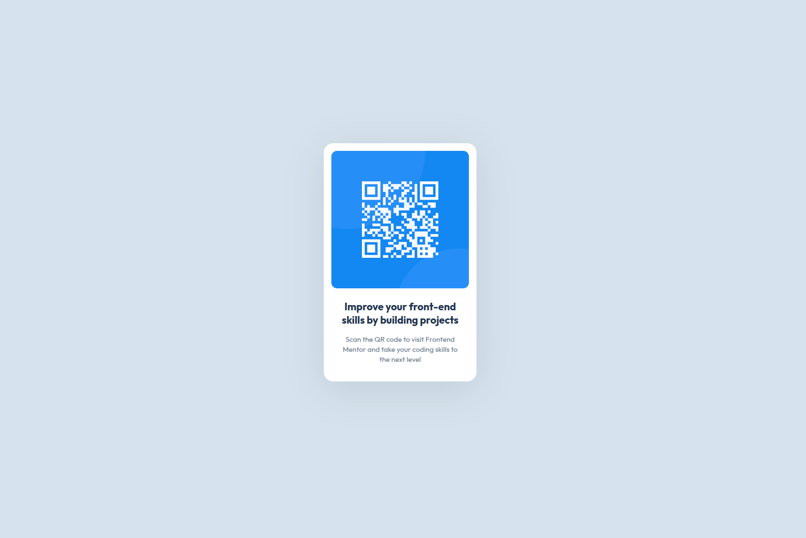

# Frontend Mentor - QR code component solution

This is a solution to the [QR code component challenge on Frontend Mentor](https://www.frontendmentor.io/challenges/qr-code-component-iux_sIO_H). Frontend Mentor challenges help you improve your coding skills by building realistic projects. 

## Table of contents

- [Overview](#overview)
  - [Screenshot](#screenshot)
  - [Links](#links)
- [My process](#my-process)
  - [Built with](#built-with)
  - [What I learned](#what-i-learned)
  - [Continued development](#continued-development)
- [Author](#author)

## Overview

### Screenshot

### Links

- Solution URL: [Solution](https://github.com/elhuzain/qr-code-component)
- Live Site URL: [Live Preview](https://elhuzain.github.io/qr-code-component)

## My process

### Built with

- Semantic HTML5 markup
- CSS custom properties
- Flexbox
- CSS Grid
- Mobile-first workflow

### What I learned

I learned how to use Flexbox to center a card both horizontally and vertically on the page. This helped me understand how a parent container can control the position of its child elements. I also practiced using CSS custom properties to keep colors and other reusable values organized.

### Continued development

In future projects, I want to become more comfortable with Flexbox and learn how its alignment properties behave in different layouts. I also want to continue practicing responsive design so my components work well across a wider range of screen sizes.

## Author

- Website - [elhuzain.com](https://elhuzain.com)
- Frontend Mentor - [@elhuzain](https://www.frontendmentor.io/profile/elhuzain)
